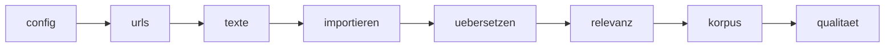

# Workflow (Snakemake)

Die ganze Pipeline als Abhängigkeitsgraph, gesteuert von `projekt.yml`. Für jedes Medium entstehen eigene Aufgaben (URLs, Texte), die Übersetzung läuft je Sprache.
So sieht man vor dem Start, was für **das eigene Thema** passieren wird, und kann Teile gezielt wiederholen.



| Stufe | Aufgabe | Pro | Stand |
|---|---|---|---|
| `config` | `projekt.yml` prüfen (Schlagwörter, Zeitraum, Fenster, Medien, Sprachen) | einmal | **läuft** (`R/config.R`) |
| `urls` | Artikel-URLs sammeln (Sitemaps, Media Cloud) und vorfiltern | Medium | Platzhalter |
| `texte` | Volltexte höflich abrufen | Medium | Platzhalter |
| `import` | Datenbank, Dubletten, Grobfilter | alle | Platzhalter |
| `uebersetzen` | ins Englische übersetzen (NLLB, lokal oder Slurm) | Sprache | Platzhalter |
| `relevanz` | Relevanz je Artikel | alle | Platzhalter |
| `korpus` | Analysekorpus exportieren | alle | Platzhalter |
| `qualitaet` | Qualitätsmarken für Übersetzungen | alle | Platzhalter |

**Stand ehrlich gesagt:** Gerüst und Konfigurationsprüfung laufen. Die Platzhalter brechen mit der Meldung ab, dass die Stufe noch nicht übernommen ist; der Code liegt im Thesis-Repository
(`vincent-219/masterarbeit-nahost`) und wird nach [docs/MIGRATION.md](../docs/MIGRATION.md) schrittweise übernommen. Die Cluster-Stufe (Slurm) ist dort bereits als Workflow gebaut und dient als Vorlage.

## Bedienung

```bash
cp projekt.example.yml projekt.yml                       # oder: Rscript setup.R
snakemake -s workflow/Snakefile -n                       # Trockenlauf: Graph für deine Medien und Sprachen
snakemake -s workflow/Snakefile --cores 4                # ausführen (Standard: nur die Stufe "config")
snakemake -s workflow/Snakefile --cores 4 --config 'stufen=[config,urls]'   # weitere Stufen zuschalten
snakemake -s workflow/Snakefile --rulegraph | python3 workflow/rulegraph_zu_mermaid.py   # Graph neu erzeugen
```

Ergebnis jeder Stufe: eine Marker-Datei unter `results/marker/`; ein erneuter Aufruf macht dort weiter, wo er abgebrochen wurde.
Geprüft: Trockenlauf mit dem Beispiel (2 Medien, 2 Sprachen → 11 Aufgaben), Ausführung der Stufe `config`, klare Fehlermeldung der Platzhalter.
